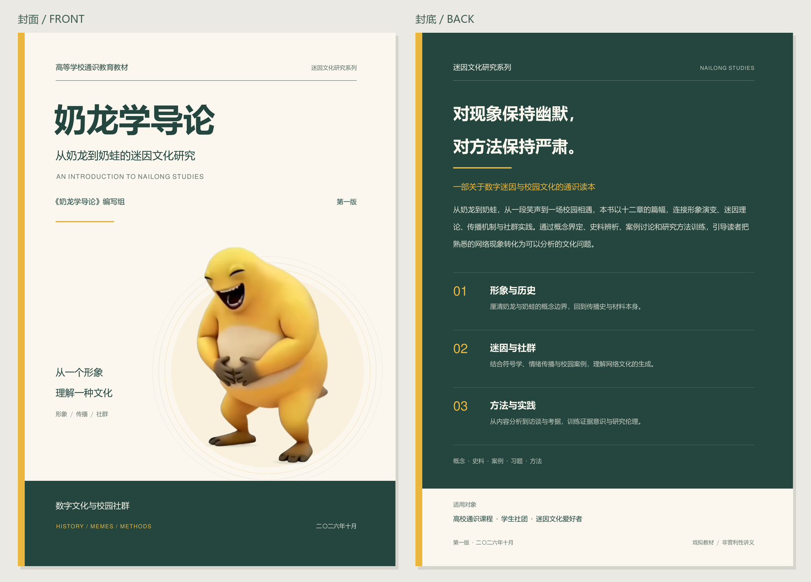

# 《奶龙学导论》

从奶龙到奶蛙的迷因文化研究。

这是一部面向高校通识课程、学生社团与自主阅读的戏拟教材。全书把一个以捧腹大笑为核心体验的网络形象作为文化研究对象，依次讨论概念边界、产业史、奶蛙前史、迷因理论、符号系统、传播机制、AIGC、产业接入、校园实践、受体研究与研究伦理。

本项目同时保存 LaTeX 工程文件和当前源码编译出的成品。仓库中的成品以本次上传前工作区的最新修订为准；当前快照编译为 **110 页 A4 PDF**。`build/` 中的临时编译文件不作为版本内容提交。

## 直接阅读

- [完整教材 PDF](output/pdf/奶龙学导论_封面优化版.pdf)
- [独立封面与封底 PDF](output/pdf/奶龙学导论_封面与封底.pdf)
- [封面与封底预览](output/covers/封面与封底预览.png)
- [封面设计说明](docs/封面设计说明.md)



## 工程结构

```text
main.tex                    主控文件，编译完整教材
covers.tex                  独立编译封面与封底
build.ps1                   Windows 一键编译脚本
style/                      全书共享的 LaTeX 样式
chapters/                   十二章正文
frontmatter/               前言、编写说明与封面
backmatter/                附录、后记与封底
refs/                      BibTeX 参考文献
figures/                   插图、示例数据与封面素材
docs/                      体例、事实口径与设计说明
tools/                     文本检查、素材处理与成品导出脚本
output/                    当前可直接阅读的 PDF、PNG 与导出检查记录
ref/img/fig-006-021.jpg   封面原貌参考图（其余本地研究素材不上传）
```

## 编译环境

推荐在 Windows 上使用：

- TeX Live 2025，包含 `xelatex`、`bibtex` 与 `makeindex`
- PowerShell
- Python 3.10+；运行成品导出脚本需要 `Pillow` 与 `pypdf`
- `pdftoppm`，用于导出封面 PNG；Poppler 已随本地工作环境配置

中文字体使用系统中的 Microsoft YaHei、SimHei、SimSun、FangSong 与 KaiTi；封面英文使用 TeX Gyre Heros。

## 编译完整教材

在仓库根目录运行：

```powershell
.\build.ps1
```

脚本会执行 XeLaTeX、BibTeX、交叉引用和索引生成，成品写入 `build/main.pdf`。脚本不会修改章节内容。

若只需要快速检查一次 LaTeX：

```powershell
.\build.ps1 -Fast
```

## 编译封面并导出成品

独立封面需要运行两遍 XeLaTeX，以稳定书签与页面标记：

```powershell
xelatex -interaction=nonstopmode -halt-on-error -output-directory=build covers.tex
xelatex -interaction=nonstopmode -halt-on-error -output-directory=build covers.tex
python tools/export_cover_outputs.py
```

导出脚本会把当前 `build/main.pdf` 复制为完整教材，并检查独立封面与完整教材的首尾页文字、页面尺寸一致，然后生成 300 dpi 的封面和封底 PNG。它只读取当前编译产物，不使用历史备份 PDF 判断内容。

封面中的奶蛙素材来自项目已有的参考图像，`figures/cover_naiwa_cutout.png` 是用于排版的透明通道素材；`tools/prepare_cover_asset.py` 可在需要时从参考图重新生成它。原始参考资料的权利归属与教材中的评论性、教学性使用边界见版权页、附录 D 和 `docs/事实手册.md`。

## 质量检查

编译后可以按以下顺序检查：

```powershell
python tools/proofscan.py
python tools/strip_noindent.py
.\build.ps1
```

`proofscan.py` 只读扫描章节格式并写入 `build/scan_report.txt`；`strip_noindent.py` 是排版整理工具，会修改章节文件，运行前请确认工作区已提交或已备份。最终 PDF 可用 `pdfinfo` 查看页数、尺寸和文件信息。

## 写作约定

章节文件遵循 `docs/体例规范.md`，事实与材料口径遵循 `docs/事实手册.md`。书中区分 A/B/C/M 四级可信度，明确把教学模型与经验事实分开，并对网络形象的版权、匿名创作者与二次创作伦理作出限制说明。

## 许可与权利

教材正文在版权页和附录 D 中声明以 CC BY-NC-SA 4.0 进行非营利性再传播。奶龙动画形象、剧集名称、相关商标以及奶蛙原始形象的权利仍归各自权利人；本仓库不主张这些第三方权利。转载或改编时，请保留署名、许可说明、来源标注与非商业限制，并自行确认素材使用权。

## 当前版本记录

当前仓库快照的完整教材由工作区最新源码编译得到，共 110 页；上传前已重新检查 PDF 页数、A4 页面尺寸、封面与封底位置、交叉引用和字体嵌入。具体导出信息见 `output/封面导出检查.txt`。
